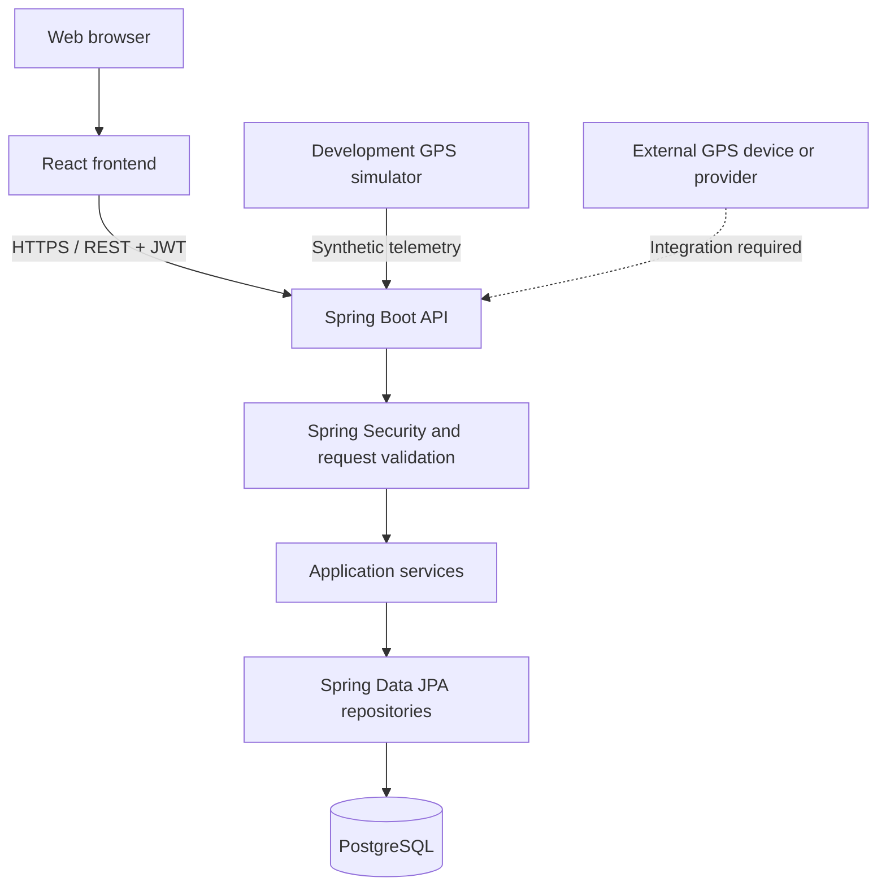

# Fleet Telematics & Vehicle Tracking System

A full-stack fleet operations platform for managing vehicles, drivers, assignments, trips, telemetry, alerts, geofences, maintenance records, and user access through a central web application and REST API.

The project uses a React frontend, a Spring Boot backend, and PostgreSQL for persistent storage. It includes JWT-based authentication, role-aware access control, automatically generated fleet identifiers, and telemetry-backed location workflows.

> **Development GPS notice:** The frontend includes a development GPS simulator that sends clearly labelled synthetic location samples for testing. It does not connect to a physical GPS tracker and must not be treated as a live vehicle-tracking feed.

## Contents

- [Overview](#overview)
- [Features](#features)
- [Technology stack](#technology-stack)
- [Architecture](#architecture)
- [Project structure](#project-structure)
- [Prerequisites](#prerequisites)
- [Local installation](#local-installation)
- [Configuration reference](#configuration-reference)
- [Application modules](#application-modules)
- [Telemetry and location behaviour](#telemetry-and-location-behaviour)
- [API overview](#api-overview)
- [Testing and build](#testing-and-build)
- [Security notes](#security-notes)
- [Current scope and limitations](#current-scope-and-limitations)

## Overview

Fleet Telematics is designed to centralise day-to-day fleet administration and monitoring. Users work with related operational records in one application: vehicles can be assigned to drivers, trips can be recorded against those assignments, telemetry can be stored and reviewed, and alerts or maintenance activities can be managed alongside the fleet assets they concern.

The frontend communicates with a versioned REST API. The backend validates incoming requests, applies authentication and role-based authorisation, executes business logic, and persists application data in PostgreSQL.

## Features

### Fleet and driver administration

- Create, view, update, and manage vehicle records.
- Automatically generate fleet numbers and tracking-device identifiers when vehicles are created.
- Maintain driver profiles and licence details.
- Automatically generate employee numbers for new drivers.
- Create driver-to-vehicle assignments and unassign active assignments.
- Associate operational records with the relevant vehicle and, where applicable, driver.

### Trips and tracking

- Record and manage scheduled and completed trips.
- Store vehicle telemetry, including coordinates, speed, heading, mileage, and other available vehicle measurements.
- View the latest recorded vehicle positions and telemetry history.
- Use the development GPS simulator to generate synthetic telemetry for interface and workflow testing.

### Monitoring and location controls

- Record GPS events associated with vehicles and optional drivers.
- Create and manage vehicle-related alerts, including acknowledgement and resolution actions.
- Create radius-based geofences using a selected vehicle's latest available telemetry position as the centre.
- Associate alerts and GPS events with the latest known vehicle position when coordinates are not supplied, subject to the relevant location data being available.

### Maintenance and administration

- Maintain scheduled and completed vehicle maintenance records.
- Manage application users and account status where authorised.
- Apply role-based access to application resources and operations.
- Retain audit-log records for relevant administrative and operational activity.
- Use dashboard and resource views to review fleet information.

## Technology stack

| Layer | Technology |
|---|---|
| Frontend | React 19, JavaScript, Vite 8 |
| Routing | React Router 7 |
| Icons | Lucide React |
| Backend | Java 21, Spring Boot 4.1.1 |
| API | Spring MVC REST endpoints |
| Persistence | Spring Data JPA / Hibernate |
| Security | Spring Security, JWT resource-server support, role-based authorisation |
| Validation | Jakarta Bean Validation through Spring Boot validation |
| Database | PostgreSQL |
| Build tools | Maven Wrapper, npm |

## Architecture



**Request flow:** The browser sends a request to the API. Spring Security authenticates the request and applies access rules. Controllers validate and pass requests to service-layer business logic. Repositories persist or retrieve data through JPA, with PostgreSQL as the system of record.

## Project structure

```text
fleet-telematics/
├── backend/
│   ├── src/
│   │   ├── main/
│   │   └── test/
│   ├── .env                  # Local configuration; do not commit
│   ├── mvnw
│   └── pom.xml
├── frontend/
│   ├── src/
│   │   ├── components/
│   │   ├── config/
│   │   ├── contexts/
│   │   └── pages/
│   ├── .env                  # Local Vite configuration
│   └── package.json
├── database/
│   └── schema.sql
├── docs/
└── scripts/
```

The `database/schema.sql` file defines the PostgreSQL tables, constraints, indexes, and timestamp triggers used by the application.

## Prerequisites

Install the following software before setting up the project:

- **Java Development Kit 21**
- **Node.js and npm** compatible with the installed Vite version
- **PostgreSQL** running locally or at a reachable database host
- **Git**

The backend includes a Maven Wrapper, so a separate Maven installation is not required.

## Local installation

The commands below use Git Bash on Windows. Run backend and frontend commands in separate terminal windows.

### 1. Clone the repository

```bash
git clone https://github.com/luvuyombewu-dev/fleet-telematics.git
cd fleet-telematics
```

To work with the current development branch:

```bash
git switch feature/complete-location-automation
git pull --ff-only origin feature/complete-location-automation
```

### 2. Create the PostgreSQL database

Create a database named `fleet_telematics`:

```bash
psql -U postgres -c "CREATE DATABASE fleet_telematics;"
```

Apply the project schema from the repository root:

```bash
psql -U postgres -d fleet_telematics -f database/schema.sql
```

You can also run `database/schema.sql` using the query tool in pgAdmin.

**Important:** The backend is configured with `spring.jpa.hibernate.ddl-auto=none` and `spring.sql.init.mode=never`. It does not automatically create the database schema at startup. Apply the SQL schema before starting the backend.

### 3. Configure the backend

Create a local file named `backend/.env`:

```dotenv
DB_USERNAME=postgres
DB_PASSWORD=replace_with_your_local_database_password
JWT_SECRET=replace_with_a_base64_encoded_secret
JWT_ISSUER=fleet-telematics
JWT_EXPIRATION_SECONDS=3600
BOOTSTRAP_ENABLED=false
APP_CORS_ALLOWED_ORIGINS=http://localhost:5173
```

Generate a suitable JWT secret in Git Bash:

```bash
openssl rand -base64 32
```

Copy the generated value into `JWT_SECRET`. It must be a Base64-encoded secret containing at least 32 bytes of key material.

Keep `backend/.env` private. Do not commit database passwords, JWT secrets, access tokens, or production credentials. The bootstrap setting is disabled by default; configure account provisioning deliberately for the environment in which the application is deployed.

### 4. Configure the frontend

Create `frontend/.env`:

```dotenv
VITE_API_BASE_URL=http://localhost:8080/api/v1
```

The API base URL must point to the backend and include the `/api/v1` prefix.

### 5. Start the backend

Open a terminal in the repository and run:

```bash
cd backend
./mvnw spring-boot:run
```

The backend uses the default Spring Boot HTTP port `8080`, unless the runtime environment overrides it.

### 6. Start the frontend

Open a second terminal in the repository and run:

```bash
cd frontend
npm install
npm run dev
```

Vite is configured to serve the frontend at:

```text
http://localhost:5173
```

Open that address in your browser. Sign in with an application account that has been provisioned for your environment.

## Configuration reference

### Backend environment variables

| Variable | Purpose | Default / requirement |
|---|---|---|
| `DB_USERNAME` | PostgreSQL username | Required |
| `DB_PASSWORD` | PostgreSQL password | Required |
| `JWT_SECRET` | Base64-encoded JWT signing/verification secret | Required; at least 32 bytes of key material |
| `JWT_ISSUER` | JWT issuer claim | `fleet-telematics` |
| `JWT_EXPIRATION_SECONDS` | Token lifetime in seconds | `3600` |
| `BOOTSTRAP_ENABLED` | Enables the configured bootstrap mechanism | `false` |
| `APP_CORS_ALLOWED_ORIGINS` | Permitted frontend origin(s) | `http://localhost:5173` |

The database URL is configured in `backend/src/main/resources/application.properties` as `jdbc:postgresql://127.0.0.1:5432/fleet_telematics`. Adjust the datasource configuration for a different database host, port, or database name.

### Frontend environment variables

| Variable | Purpose | Local value |
|---|---|---|
| `VITE_API_BASE_URL` | Backend API base URL | `http://localhost:8080/api/v1` |

Restart the Vite development server after changing frontend environment variables.

## Application modules

| Module | Responsibility |
|---|---|
| Dashboard | Fleet overview and operational summaries |
| Vehicles | Vehicle records, fleet identifiers, and tracking-device identifiers |
| Drivers | Driver profiles, employee identifiers, and licence details |
| Driver assignments | Driver-to-vehicle assignment lifecycle |
| Trips | Trip scheduling and journey records |
| Live tracking | Latest telemetry and recorded location history |
| GPS events | Event records linked to vehicle and optional driver |
| Alerts | Operational alerts, acknowledgement, and resolution |
| Geofences | Radius-based location boundaries |
| Maintenance | Vehicle maintenance schedules and service records |
| User management | User administration and account status, subject to role permissions |
| Audit logs | Review of recorded application activity |

## Telemetry and location behaviour

Location-dependent workflows use stored telemetry rather than asking a user to type coordinates during normal record creation.

- A vehicle's latest stored telemetry can be used to supply location data for supported GPS events and alerts.
- A geofence is centred on the latest available telemetry position of the vehicle selected during creation.
- Updating a GPS event without new coordinates preserves its existing historical coordinates.
- The development simulator sends synthetic location samples at a regular interval and is intended for development and functional testing only.

The simulator does not represent a physical tracker. Real-world tracking requires compatible GPS hardware or a telematics provider, a defined device identity and ingestion integration, and suitable production security and monitoring.

## API overview

The frontend uses the versioned API base path:

```text
/api/v1
```

The backend exposes REST resources for the following areas:

| Resource | API path |
|---|---|
| Authentication | `/auth` |
| Dashboard | `/dashboard` |
| Vehicles | `/vehicles` |
| Drivers | `/drivers` |
| Driver assignments | `/driver-assignments` |
| Trips | `/trips` |
| Telemetry | `/telemetry` |
| GPS events | `/gps-events` |
| Alerts | `/alerts` |
| Maintenance records | `/maintenance-records` |
| Geofences | `/geofences` |
| Users | `/users` |
| Audit logs | `/audit-logs` |

For example, the vehicles resource is available under `/api/v1/vehicles`. Authentication and authorisation are enforced by the backend; access to individual operations depends on the authenticated user's role.

## Testing and build

### Backend tests

From the repository root:

```bash
cd backend
./mvnw clean test
```

### Frontend production build

From the repository root:

```bash
cd frontend
npm run build
```

A successful frontend build writes the production bundle to `frontend/dist/`.

### Functional checks

The repository includes a functional test script at `scripts/test-fleet-functionality.mjs`. Run it only after reviewing its configuration and ensuring the backend, database, and test account are prepared for the checks it performs.

## Security notes

- JWT authentication and backend role-based authorisation protect API operations.
- Passwords are handled by the backend; never store plaintext passwords in source control.
- Keep `.env` files, JWT secrets, database credentials, and tokens out of commits.
- Restrict CORS to the actual frontend origin in each environment.
- Use HTTPS and managed secrets for deployed environments.
- Review role permissions before creating or activating user accounts.
- Do not expose development-only tools or synthetic telemetry as production tracking capabilities.

## Current scope and limitations

- The development GPS simulator generates synthetic test telemetry. Physical GPS hardware/provider integration is not included by the simulator.
- Live position display depends on telemetry being ingested and stored by the backend.
- Geofences currently use a centre coordinate and radius; they are not arbitrary polygon boundaries.
- The project requires an existing PostgreSQL database schema; schema creation is not performed automatically by Hibernate or Spring SQL initialisation.
- Deployment infrastructure, production secrets management, and a live telematics-provider integration must be configured for the target operating environment.

## License

No license file is currently included in the repository. Unless a license is added, the source should not be assumed to be available for unrestricted reuse, modification, or redistribution.
